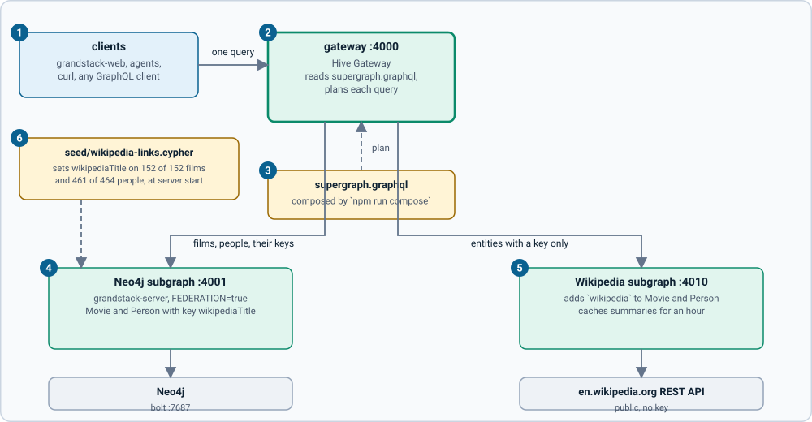
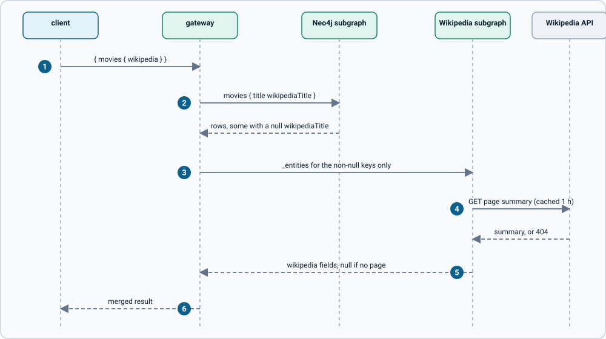

# How it works

## The pieces

| Where | What |
| --- | --- |
| `grandstack-server` with `FEDERATION=true` | The **Neo4j subgraph**. Same schema and data as before, served with `getSubgraphSchema()` so it also answers `_service` and `_entities` |
| `schema/federation.graphql` | Extra schema for that server: the federation `@link`, `@key` on Movie and Person, and the `wikipediaTitle` and `wikidataId` fields |
| `seed/wikipedia-links.cypher` | Generated links, run at every server start |
| `wikipedia/` | The **Wikipedia subgraph**: adds `wikipedia` to Movie and Person |
| `gateway/` | The composed `supergraph.graphql`, `mesh.config.ts` that makes it, and the gateway's config and Dockerfile |
| `scripts/` | `resolve-links.ts` (builds the links), `matching.ts` (the matching rules), `smoke.ts` |

## The stack

1. **Clients** call one endpoint and need to know nothing about subgraphs.
2. **The gateway** reads the supergraph, splits each query into parts for the subgraphs, and merges the answers.
3. **The supergraph** is a file describing both subgraphs' schemas and which subgraph owns which field.
4. **The Neo4j subgraph** owns Movie and Person. Both are *entities* with the key `wikipediaTitle`.
5. **The Wikipedia subgraph** extends the same two types by key, adding one field to each.
6. **The links file** gives nodes their key.

## One query, step by step

1. The client sends `{ movies { wikipedia } }`-style queries to the gateway.
2. The gateway asks the Neo4j subgraph for the movies and their `wikipediaTitle`.
3. It sends **only the rows that have a key** to the Wikipedia subgraph as entity representations (`_entities`). A film with no link is skipped, so its `wikipedia` is simply `null`.
4. The Wikipedia subgraph answers from its in-memory cache (one hour), or calls Wikipedia's summary endpoint.
5. It returns the fields, or `null` when Wikipedia has no such page.
6. The gateway returns one merged result.

A page that does not exist is just `null`. If Wikipedia is slow, rate limiting or unreachable, the Wikipedia subgraph answers with a GraphQL error (code `WIKIPEDIA_UNAVAILABLE`, checked directly against the subgraph), and the field is `null`. If the Wikipedia subgraph itself is down, the gateway returns `wikipedia: null` with the error `Unexpected error.` (checked by stopping the container). In both cases the Neo4j fields are still returned.

## What federation changes for what you already have

- The data model, the seed and the default stack are unchanged. Federation is opt-in (`compose.federation.yaml`).
- `grandstack-web` is unchanged: it calls port 4000, which is now the gateway. Its 78-check browser run passes through the gateway.
- The Neo4j subgraph moves to port 4001 so the gateway can have 4000.
- The supergraph exposes everything the server did, plus `wikipedia`, `wikipediaTitle`, `wikidataId` and `WikipediaSummary`.

## Auth and agents

- **Auth is not combined here.** This stack is open, like the default one. Putting `grandstack-auth` in front of a federated graph is a separate task: the gateway would validate tokens and forward the `Authorization` header to the subgraphs. That is not built or tested.
- **Agents see both subgraphs.** Point `grandstack-agents` at the gateway (`GRAPHQL_URL=http://localhost:4000/graphql`) and its tools work unchanged: `get_schema` now includes `WikipediaSummary` and the `wikipedia` fields (the summary grew from about 4.6 KB to about 6.4 KB), and `run_query` returned the Wikipedia description for *Heat* in a check. Describe cross-subgraph fields well: an agent can only use what the descriptions tell it, and a field that says "null when not linked" saves it a wrong guess.
