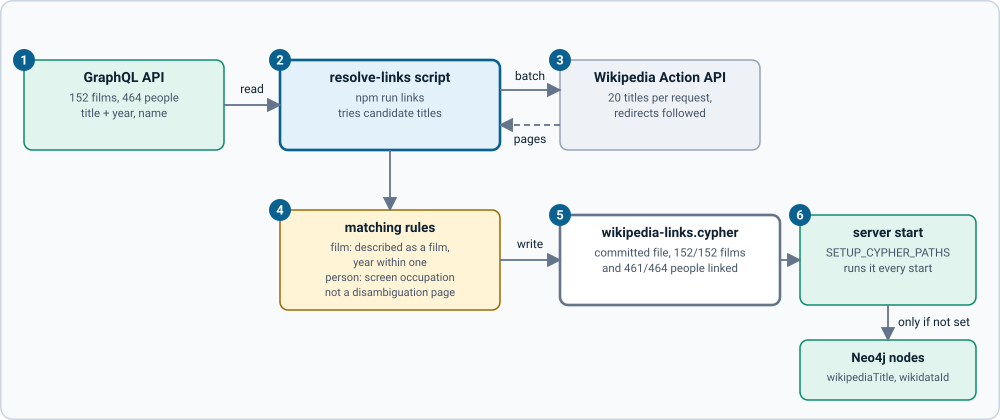

# Linking films and people to Wikipedia

Federation needs a key: for each film and person, the title of its English Wikipedia page. Looking titles up at request time is unreliable (we saw *Heat*, *Alien*, *Parasite* and *Gladiator* land on the wrong pages), so the links are built once, by a script, checked by rules, and committed.



1. **The GraphQL API** supplies every film (title, year) and person (name).
2. **`npm run links`** (`scripts/resolve-links.ts`) tries candidate page titles for each: `Heat (1995 film)`, `Heat (film)`, `Heat`; for people `Name`, `Name (actor)`, `Name (actress)`, `Name (director)`, `Name (filmmaker)`. It tries them in rounds, so each round is a few batched requests.
3. **The Wikipedia Action API** answers 20 titles per request (description, intro text, Wikidata id, disambiguation flag), following redirects. (The REST summary endpoint, which the subgraph uses at run time, is rate limited hard for pages it has not cached; one page at a time took an hour. Batching takes about a minute.)
4. **The matching rules** (`scripts/matching.ts`, unit tested with recorded responses) accept a page only if it passes: for a film, a normal page whose title says "(YYYY film)" with the right year, or whose description says it is a film and mentions the release year (give or take one); for a person, a normal page whose description names a screen occupation (actor, actress, director, filmmaker, producer, screenwriter, comedian, cinematographer, stuntman, animator, sound designer; plurals too). Disambiguation pages, missing pages and namesakes with other jobs are rejected.
5. **`seed/wikipedia-links.cypher`** is the committed result: two `UNWIND` statements that set `wikipediaTitle` and `wikidataId`.
6. **The server runs it at every start** (`SETUP_CYPHER_PATHS`). It only sets a link that is not set yet (`WHERE m.wikipediaTitle IS NULL`), so restarts are harmless and hand-set links are kept.

## Coverage

Run on 2026-10-22 against the 152-film, 464-person sample data:

| | Linked | Not linked |
| --- | --- | --- |
| Films | 152 of 152 | none |
| People | 461 of 464 | Carrie Henn, Madonna, John Legend |

Why the three are missing: the rules are strict on purpose (a wrong link is worse than none). *Carrie Henn* has no page of her own; Wikipedia redirects her name to the film *Aliens*, which the rules correctly refuse. *Madonna* and *John Legend* have pages, but they are described as singers, an occupation the rules do not accept (adding it would also accept namesakes with other jobs, such as the presenter Chris Evans). Unlinked entries return `wikipedia: null`. To link one, see [recipes](recipes.md#link-one-more-film-or-person).

Things the rules did on purpose that you may notice: a duo that shares one page links both people to it (*Lana* and *Lilly Wachowski* to *The Wachowskis*, *Anthony* and *Joe Russo* to *Russo brothers*); and two films (*The Pianist*, *Gravity*) are accepted by the page title, "(2002 film)" and "(2013 film)", because their one-line descriptions do not say "film".

**Checked by eye:** the cases where the page title differs from ours were reviewed (for example *Se7en* to *Seven (1995 film)*, *Zoe Saldana* to *Zoe Saldaña*, *Chris Evans* to *Chris Evans (actor)*), and 14 random people were checked against their descriptions. That is a sample, not a proof: some links among the other several hundred could still be wrong. Report one and fix it by hand-editing the entry or adding a rule.

## Running it again

```sh
npm run links      # needs the stack running (the GraphQL API) and internet
```

It reads the films and people from `GRAPHQL_URL` (default `http://localhost:4000/graphql`, the gateway in the federation setup or the plain server in the default one; either works).

Responses are cached in `scripts/.cache/` (not committed), so an interrupted run resumes. If Wikipedia answers 429 the script waits as long as the server asks and retries. Set `WIKIPEDIA_USER_AGENT` to identify yourself. Review `git diff seed/wikipedia-links.cypher` before committing: Wikipedia changes, and so can the matches.

## Licence

Text and images from Wikipedia are available under CC BY-SA 4.0 and the licences stated on each page. The `WikipediaSummary` description says so and includes `pageUrl`; show a link to the article wherever you display this content.
